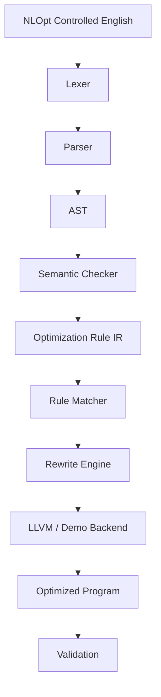

# NLOpt Architecture

The NLOpt compiler is organized into the following logical components:

## Frontend
- **Lexer** (`src/lexer/lexer.l`): Tokenizes the restricted English input using Flex.
- **Parser** (`src/parser/parser.y`): Parses the tokens against the CFG using Bison and generates the AST.

## Middle-end
- **AST** (`src/ast/`): Represents the syntactic structure of the optimization rule.
- **Semantic Checker** (`src/semantic/checker.cpp`): Validates that the rule operations and operands are logically sound and safe for the target domain.
- **Rule IR** (`src/rule_ir/rule_ir.cpp`): A language-agnostic Intermediate Representation of the optimization rule that strips away the original English structure.

## Backend
- **Matcher & Rewriter** (`src/optimizer/`): A generic pattern matching and rewriting engine that recursively applies the Rule IR to a target expression tree.
- **Demo IR** (`src/backend/demo_ir.h`): An internal representation of mathematical expressions (add, sub, mul, div) to demonstrate the optimizations.
